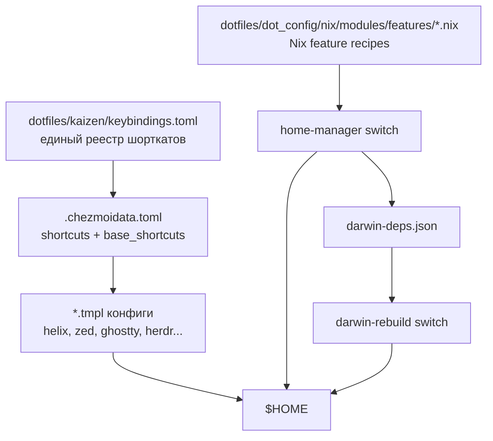

# Kaizen — Design Document

## Проблема

- Эксперименты с инструментами оставляют следы: шаблоны разрастаются, удалить фичу чисто нельзя
- Три инструмента (nix/mise/chezmoi) не знают друг о друге
- Шорткаты задаются отдельно в каждом инструменте; нет единого реестра
- Go-шаблоны ломают синтаксис конфиг-файлов в редакторе
- Нет cross-feature коммуникации (skhd не знает что aerospace хочет зарегистрировать шорткат)

## Приоритеты

1. **Воспроизводимость** — быстрая настройка на новой машине
2. **Изоляция** — удалил фичу, ничего не сломалось
3. **Единый реестр шорткатов** — `keybindings.toml` как source of truth

---

## Текущая архитектура

### Три типа файлов

| Тип         | Пример                                  | Управление                             |
| ----------- | --------------------------------------- | -------------------------------------- |
| Статические | themes/, languages.toml                 | chezmoi source → $HOME                 |
| Шаблонные   | helix/config.toml, zed/keymap.json      | chezmoi .tmpl → $HOME                  |
| App-owned   | flake.lock, mise.lock, pi/settings.json | app пишет, `kaizen re-add` захватывает |

---

## Шорткаты

`keybindings.toml` — единственный источник правды:

- `[shortcuts]` — базовые QWERTY значения
- `[layout.colemak.shortcuts]` — overlay для Colemak
- `kaizen apply` экспортирует в `.chezmoidata.toml` два раздела:
  - `[kaizen.shortcuts]` — с layout overlay (для терминала, Colemak-aware)
  - `[kaizen.base_shortcuts]` — без overlay (для GUI Cmd+key, QWERTY-fixed)

### Правило: Cmd/Super на macOS использует QWERTY

Karabiner ремапит обычные клавиши через Colemak, но `Cmd+key` остаётся QWERTY.
Поэтому в GUI шаблонах (Zed) используется `base_shortcuts`, в терминале (herdr) — `shortcuts`.

---

## Nix features

Фичи — Nix recipe-атрсеты в `dotfiles/dot_config/nix/modules/features/*.nix`.
`feature-loader.nix` централизованно генерирует HM-модули из рецептов.

Darwin-зависимости передаются через JSON-bridge:

1. HM activation → `~/.config/kaizen/darwin-deps.json`
2. `darwin-rebuild` читает json, применяет brew deps

---

## Жизненный цикл

| Команда            | Что делает                                                  |
| ------------------ | ----------------------------------------------------------- |
| `kaizen apply`     | chezmoi apply + экспорт шорткатов в chezmoidata             |
| `kaizen sync`      | chezmoi apply → home-manager switch → darwin-rebuild → mise |
| `kaizen update`    | обновление пакетов через Nix update hooks                   |
| `kaizen bump`      | bump lock-файлов (mise.lock, flake.lock)                    |
| `kaizen re-add`    | захватить изменения app-owned файлов обратно в dotfiles     |
| `kaizen configure` | wizard включения/выключения Nix features                    |
| `kaizen doctor`    | диагностика: версия, features, dotfiles source              |

---

## Backlog

- `run.*` namespace в keybindings.toml — шорткаты для запуска задач
- `open.*` namespace — открытие внешних приложений
- xontrib-runner — project-aware task picker (justfile/package.json/Makefile/Cargo.toml)
- Helix: `space r s` биндинг для run script
